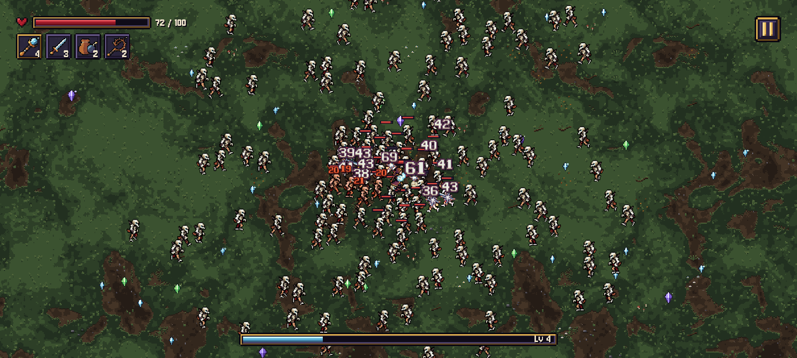
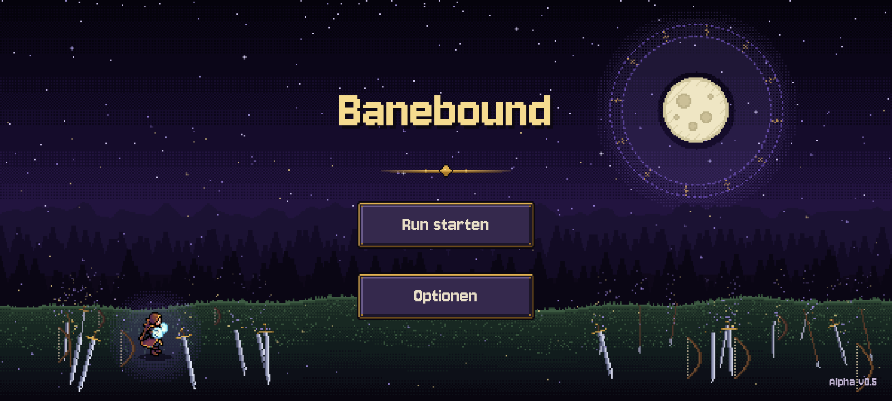
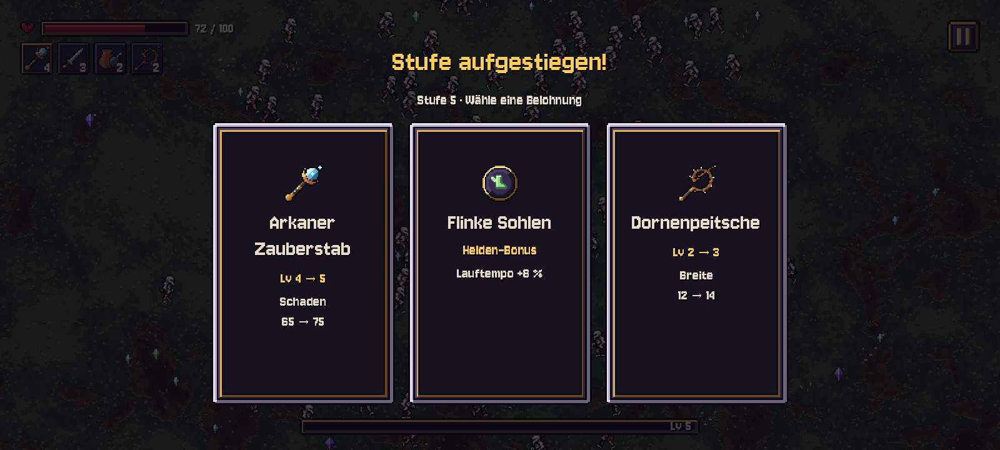
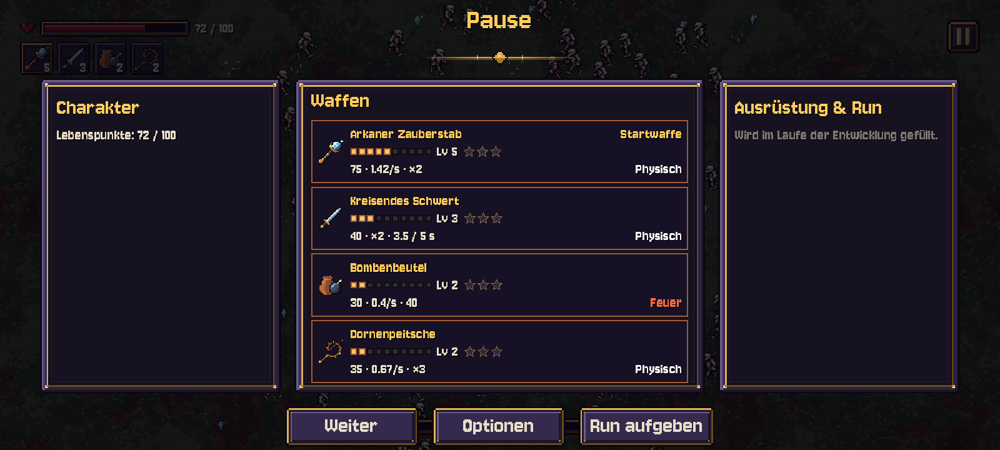

# Banebound

**A dark-fantasy survivor-like for Android. Your weapons only exist while you fight, so make every expedition count.**

Venture into cursed forests and forgotten ruins, cut down endless hordes of monsters with weapons that are forged
from pure need, and return to rebuild a village that the old wars left in ashes.

  

| Main menu | Level-up | Status screen |
|---|---|---|
|  |  |  |

Screenshots from Alpha v0.5, recorded on PC in the aspect ratio of the test phone (20:9).

---

## The Weapon Bane

> Long ago the world drowned in war. Humans, elves, dwarves and all the other peoples fought one another,
> generation after generation, until there were no victors left – only scorched earth and nameless graves.
>
> Then the High Circle, the mightiest council of mages, cast the Bane upon the world. In a single night every
> blade, bow and staff crumbled to dust, and the war was over.
>
> But the Bane is a curse with a condition: when a mortal faces the gravest danger, a weapon **materialises in
> their hand** – bound to them, steeped in ancient magic. And once the danger has passed, it **destroys itself**.
>
> No nation can ever march to war again. But against the monsters awakening in the wild, you can still fight back.

---

## Features

- **Expeditions, not arenas** – every run is a journey through a handcrafted map, wave after wave, 10 to 20 minutes long.
- **Auto-attacks plus a special ability** – focus on movement and positioning, then unleash your ability at the right moment.
- **Weapons that vanish** – up to three weapons per run, granted on level-up. Push one to level 10 and evolve it into one of
  three variants, then evolve again: **nine final forms per weapon**.
- **Resting places between waves** – meet wandering merchants, buy potions and run-long artefacts with the Magic Scrap
  you collected.
- **Armour that stays** – armour is no weapon, so the Bane cannot touch it. Equip your hero on a paperdoll with
  classic RPG slots.
- **Rebuild your village** – bring materials home from successful expeditions to restore the smith, the alchemist,
  the enchanter and more, and unlock permanent upgrades.
- **Hundreds of enemies on screen** – built from the ground up to stay smooth on mid-range phones.
- **Made for touch** – floating or fixed joystick, left, right or both sides of the screen, adjustable transparency.
- **Save and continue** – leave mid-run and pick up later. No save-scumming: shop offers and level-up choices are
  locked in.

## Current status – Alpha v0.5

Banebound is in early development. The core combat loop is playable; expeditions, waves and the village are next.

**Playable now**

- Free movement through a forest arena with a touch joystick (floating or fixed)
- Endless skeletons that swarm the hero – stays smooth with several hundred enemies on a mid-range phone
- **Six weapons**, each with its own attack pattern: Arcane Wand (aimed bolts), Orbiting Sword, Flame Torch (fire aura),
  Trident (lightning strikes), Bomb Bag (bombs with a warning zone) and Thorn Whip
- **Elements and status effects:** burning, poison, chain lightning (shock) and frost
- **Soul shards (XP)** dropped by enemies, pulled in by a pickup radius
- **Level-ups with three cards:** new weapons, weapon upgrades and hero boons in three rarities (common, rare, epic)
- HUD with health, XP bar and weapon slots; pause screen with detailed weapon stats and chosen upgrades
- Options for joystick, damage numbers, health bars, screen shake and vibration

**Coming next**

- Waves with a timer, ranged enemies and bosses, and a run that can be won
- Resting places with merchants between waves
- Weapon evolutions from level 10, special abilities, saving and continuing a run
- The village hub, armour and permanent upgrades

## Controls

| Action | Phone | PC (testing) |
|---|---|---|
| Move | Virtual joystick | WASD / arrow keys |
| Attack | Automatic | Automatic |
| Pause / status screen | Pause button or back gesture | Esc |

Joystick mode, screen side and transparency can be changed in **Options**.

## Download

Get the latest APK from the [**Releases**](https://github.com/Slydee23/android-bullet-heaven/releases) page.

- Android 7.0 or newer
- Landscape, optimised for 16:9 to 21:9 screens
- Languages: German (English coming soon)

## Built with

- [Godot Engine 4.7](https://godotengine.org) – GDScript, Mobile renderer
- 2D pixel art, rendered at 4× with nearest-neighbour filtering
- Enemies without physics bodies, a spatial grid and object pooling to keep frame rates high with hundreds of enemies

### Running from source

1. Install [Godot 4.7](https://godotengine.org/download) (standard version, not .NET).
2. Clone this repository and open `project.godot` in Godot.
3. Press **F5** to play on your PC, or use *Remote Debug* to deploy to an Android device.

## License

© 2026 Slydee23. **All rights reserved.**

The source code is published for viewing only. You may not copy, modify, distribute or use this code, its assets or
the game itself, in whole or in part, without prior written permission.
